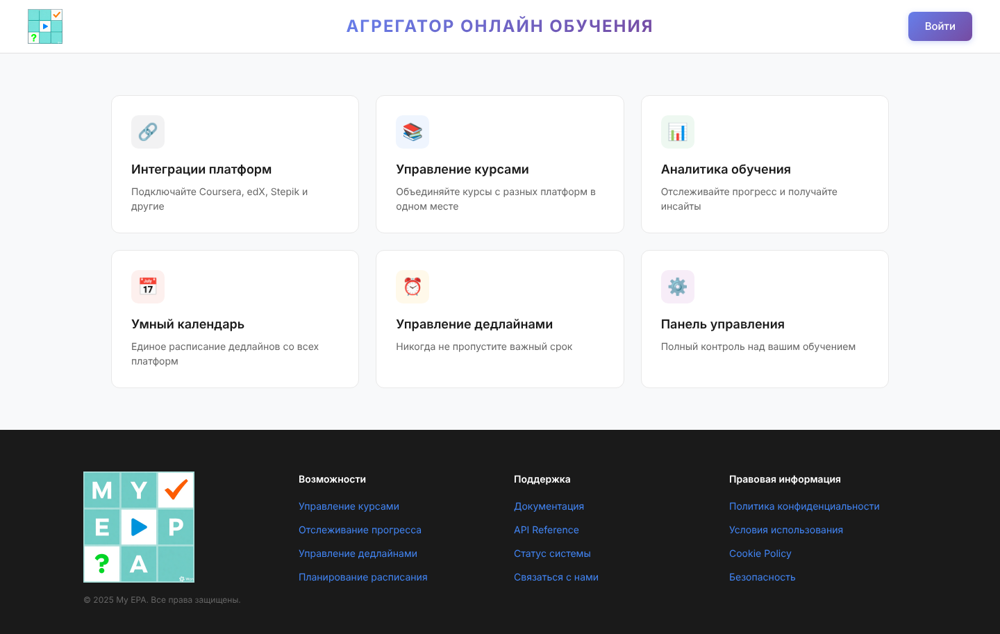
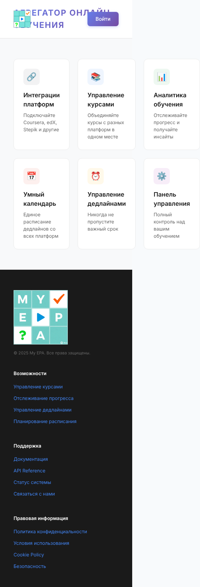
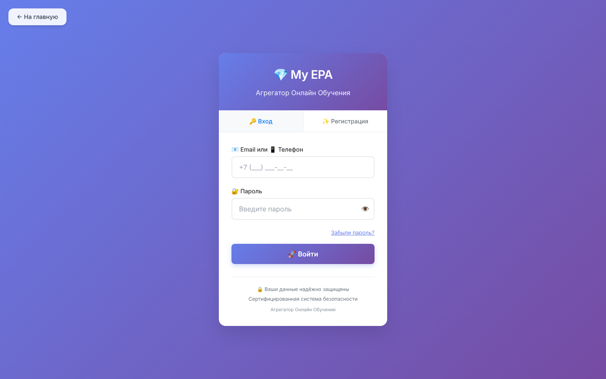

# Сайт My EPA: замечания и предложения

Обзор от 24.10.2026: публичная часть (лендинг, страницы футера), вход и регистрация, меню кабинета.
Сверено с планом продукта (`docs/PRODUCT-PLAN.md`).

**Как смотрели.** Лендинг и вход сняты с локальной сборки ветки `main` и сверены с живым myepa.ru: на
телефоне (390 px) страница шириной 585 px — так же, как на снимке ниже. Кабинет без базы данных не
запускается, его смотрели по коду. Снимки: `docs/site-review/`.

| Компьютер | Телефон (390 px) | Вход |
|---|---|---|
|  |  |  |

## Главное

1. **Лендинг не объясняет, что это и для кого.** Нет заголовка и подзаголовка, нет картинки продукта,
   нет кнопки регистрации — только «Войти». Посетитель видит шесть общих карточек («Панель управления —
   полный контроль над вашим обучением») и не понимает, чем My EPA отличается от кабинета любой площадки.
2. **На телефоне вёрстка сломана.** Логотип, заголовок и кнопка «Войти» налезают друг на друга, карточки
   всегда в три колонки, страница шире экрана (горизонтальная прокрутка). Причина — абсолютное
   позиционирование в шапке и сетка `repeat(3, 1fr)` без адаптации (`client/src/components/LandingPage.tsx`).
3. **Регистрация закрыта для иностранцев.** Телефон обязателен и проверяется как российский
   (`validateRussianPhone`, маска `+7`), в базе `users.phone` — обязательное уникальное поле. Для
   международного продукта это блокер.
4. **Нет согласия на обработку персональных данных.** При регистрации нет галочки согласия и ссылки на
   политику; политика конфиденциальности — общий текст без оператора, целей, сроков хранения, трансграничной
   передачи. Это требование 152-ФЗ, а для учеников из ЕС — GDPR. Черновики решено делать самим.
5. **Есть утверждения, которые не соответствуют действительности:**
   - «Статус системы» — статичный текст «все сервисы работают, инцидентов за 30 дней нет», без проверки;
   - «Сертифицированная система безопасности» на форме входа и «регулярные аудиты безопасности» в политике;
   - meta description обещает «85+ платформ», страница «Управление курсами» перечисляет Khan Academy,
     LinkedIn Learning, Pluralsight, Codecademy — интеграций с ними нет.

   Вы решили пока оставить обещания про Coursera, edX и «умный календарь» как цель. Пункты выше — другое:
   выдуманный статус и сертификация создают юридический риск и подрывают доверие площадок на переговорах.
   Предлагаю убрать именно их.

## Предложения

### Быстро (1–2 дня, без изменения модели данных)

| # | Что сделать | Зачем |
|---|---|---|
| 1 | Первый экран: заголовок «Все курсы, уроки, вебинары и экзамены — в одном календаре», подзаголовок «Подключите площадки, получайте напоминания и ссылки на уроки и материалы», кнопки «Начать бесплатно» и «Войти», картинка календаря | понятно с первого взгляда, есть путь к регистрации |
| 2 | Адаптивная вёрстка лендинга: шапка на flex, карточки 1 / 2 / 3 колонки | сайт работает на телефоне |
| 3 | Убрать статичный «Статус системы» (или показывать реальную проверку `/api/health`), «сертифицированную систему», «аудиты», «85+ платформ», список неподключённых площадок | честность, меньше риска |
| 4 | Галочка согласия на обработку данных при регистрации со ссылками на политику и условия | 152-ФЗ |
| 5 | Убрать `maximum-scale=1` из `client/index.html` | на телефоне можно увеличить текст (доступность) |
| 6 | Шрифты: сейчас на каждой странице грузятся ~25 семейств Google Fonts; оставить 1–2 и хранить на своём сервере | скорость загрузки, в т. ч. в РФ; Google Fonts передаёт IP посетителя в Google — вопрос GDPR |
| 7 | © 2025 → текущий год (автоматически), заголовок h1 на лендинге, Open Graph теги для ссылок в мессенджерах | аккуратность, поиск, превью ссылок |
| 8 | Единый логотип: на лендинге два разных, на форме входа — эмодзи 💎; эмодзи в подписях полей формы заменить иконками | солидный вид для международных партнёров |

### Средне (вместе с этапами 1–2 плана)

| # | Что сделать | Зачем |
|---|---|---|
| 9 | Страницы футера сделать отдельными адресами: `/about`, `/privacy`, `/terms`, `/cookies`, `/contacts`, `/partners`, `/docs/api` (сейчас это состояние внутри лендинга, адреса нет) | их можно дать ссылкой, их видит поиск; адрес политики нужен при регистрации OAuth-приложений на площадках |
| 10 | Раздел **«Для площадок»**: зачем площадке обмен с My EPA (удержание учеников, напоминания, видимость в каталоге), как подключиться, ссылка на публичную спецификацию формата, форма заявки на партнёрство | основа модели «договоры с площадками» |
| 11 | «API Reference» заменить на документацию партнёрского API (сейчас там внутренний API кабинета) | площадки видят, что им внедрять |
| 12 | Регистрация для всех стран: email — основной, телефон — необязательный и в международном формате; выбор страны → регион хранения данных (по плану, контуры РФ / ЕС / мир) | международные ученики |
| 13 | Английская версия сайта и кабинета, переключатель языка (сейчас всё только на русском, переводов в коде нет) | международные площадки и ученики |
| 14 | Блоки для сегментов: взрослым, студентам, школьникам и родителям, компаниям | все сегменты — по решению владельца |
| 15 | Лендинг перевести на те же компоненты, что кабинет (Tailwind + shadcn/ui), вместо стилей, прописанных прямо в разметке | один стиль, проще поддерживать |

### Кабинет (вместе с этапом 1)

| # | Что сделать | Зачем |
|---|---|---|
| 16 | Новое меню: Сегодня, Календарь, Курсы, Материалы (библиотека), Записи, Площадки, Настройки | меню следует за главным сценарием «что у меня на неделе» |
| 17 | Главная = «Сегодня»: ближайшие уроки, вебинары с кнопкой «Войти», дедлайны и экзамены со ссылками | главный экран отвечает на главный вопрос ученика |
| 18 | Убрать мёртвый код: `client/src/components/layout/Sidebar.tsx` (меню от шаблона: «accounts», «investments»), продублированный список пунктов меню в `App.tsx` | меньше путаницы при переделке |
| 19 | «Площадки»: у каждой подключённой — статус обмена (последняя синхронизация, ошибки), кнопка «Подключить» по способу площадки (OAuth, код, email, ссылка-фид) | ученик видит, что данные свежие |

## Что сделано

Раздел «Быстро» (пункты 1–8) и адреса страниц (пункт 9) — PR #31 (задача #28).

## Что не проверено

- Кабинет вживую (нужна база).
